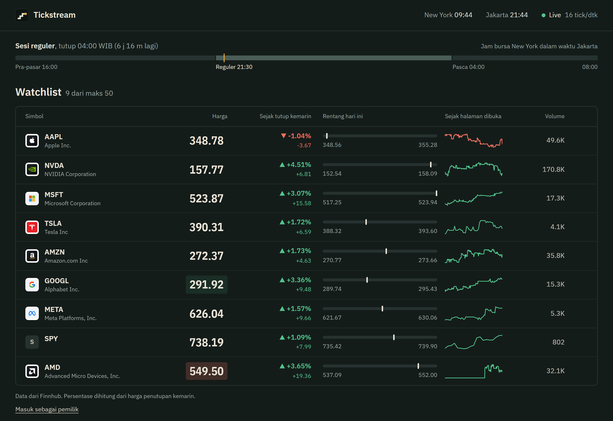
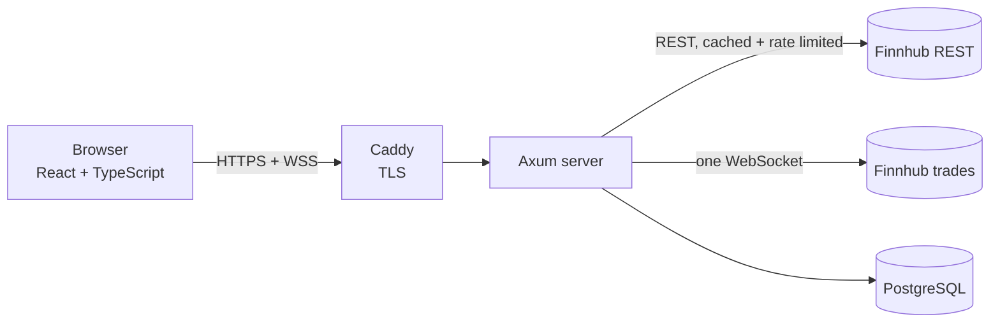

# Tickstream

[](https://github.com/MaulanaRhezaArdiansyah/tickstream/actions/workflows/ci.yml)

A real-time watchlist for US stocks and crypto. The backend is Rust (Axum, Tokio, SQLx), the
frontend is React with TypeScript, and the market data comes from Finnhub's free tier.

**Live demo:** https://tickstream.rhezaardiansyah.com



The interface and the code comments are in Indonesian. The code itself, commit messages and this
README are in English.

## What it does

- Streams live trades over WebSocket. Each row shows the price, the change since yesterday's
  close, today's range, a sparkline and the volume since the page was opened.
- Shows where the New York trading day is (pre-market, regular, after-hours) in Jakarta time.
- Searches about 11,000 US stocks and ETFs by ticker or company name, entirely in the browser.
- Keeps the watchlist in PostgreSQL. Anyone can view it; only the owner can change it.

## Architecture



The free Finnhub plan allows a single WebSocket connection per API key, so browsers never talk to
Finnhub directly. The server holds that one upstream connection and fans trades out to every open
page through a Tokio broadcast channel. A hub counts subscribers per symbol: the server subscribes
upstream when the first page asks for a symbol and unsubscribes when the last one leaves. Each page
holds a `Subscription` guard whose `Drop` releases its symbols, so a closed tab cannot leak them.

In production the same binary serves the built React app, so the page, the API and the WebSocket
share one origin and need no CORS rules.

## Design notes

**The API key stays on the server.** The browser only sees `/api/*` and `/ws`. The key is read
from the environment and wrapped in `secrecy::SecretString`, so it cannot end up in a log line by
accident.

**Staying inside the free tier.** Outgoing REST calls go through a rate limiter (60 per minute,
bursts of 25) that waits up to two seconds for a slot and then fails fast instead of queueing.
In front of it sits a cache: quotes for 15 seconds, company profiles and the symbol list for a day,
market status for a minute. Failed calls are not cached. The cache is a decorator over a
`MarketData` trait, which also lets the route tests run against a fake.

**Public but read-only.** Visitors can watch; changing the watchlist needs an owner token sent as
`Authorization: Bearer`, checked in constant time by an Axum extractor. Without `ADMIN_TOKEN` the
watchlist is read-only. Quotes, profiles and live subscriptions are served only for symbols on the
watchlist, so a visitor cannot spend the API quota or fill the 50 live slots with other symbols.

**Rendering hundreds of trades a second.** Trades land in a store outside React. It publishes a new
snapshot at most once per animation frame, components read it with `useSyncExternalStore`, and
memoised rows re-render only when their own symbol changed.

**Connections that drop.** The upstream stream reconnects with exponential backoff (1 to 30
seconds) and resubscribes every symbol still wanted. The browser reconnects on its own and shows
the connection state in the header.

**Shutting down cleanly.** On SIGTERM or Ctrl+C a cancellation token stops new work, a task tracker
waits for open WebSocket clients, and the upstream connection is closed politely, so a restart does
not leave Finnhub thinking the old connection is still alive.

**SQL checked at compile time.** Queries use `sqlx::query!`, verified against the schema when the
server compiles. The `server/.sqlx` cache lets CI and the Docker build compile without a database.

**A big list, filtered locally.** The symbol list is fetched once, about 140 KB gzipped. Filtering
it in the browser takes a few milliseconds per keystroke, so search needs no extra API calls. The
add field is an ARIA combobox that works from the keyboard.

## Stack

| Part | Tools |
| --- | --- |
| Server | Rust 2024, Axum 0.8, Tokio, SQLx (PostgreSQL), reqwest, tokio-tungstenite, moka, governor |
| Web | React 19, TypeScript, Vite, oxlint |
| Infrastructure | Docker (multi-stage build), GitHub Actions, GHCR, nginx or Caddy |

## Running locally

You need Rust (stable), Node.js 20+, Docker for PostgreSQL, and a free
[Finnhub API key](https://finnhub.io/register).

```sh
docker compose up -d          # PostgreSQL on localhost:5433

cd server
cp .env.example .env          # set FINNHUB_API_KEY, and ADMIN_TOKEN to edit the watchlist
cargo run                     # http://localhost:8080

cd ../web
npm install
npm run dev                   # http://localhost:5173, proxies /api and /ws to :8080
```

Running the server on another port? `API_TARGET=http://127.0.0.1:8090 npm run dev`.

Finnhub allows one WebSocket per API key, so do not run two servers with the same key: the
connections keep closing each other.

### API

| Endpoint | |
| --- | --- |
| `GET /health` | `ok` |
| `GET /api/watchlist` | Watched symbols |
| `POST /api/watchlist` | Add `{"symbol":"AMD"}` (owner) |
| `DELETE /api/watchlist/{symbol}` | Remove (owner) |
| `GET /api/admin` | 204 if the bearer token is the owner's |
| `GET /api/quote?symbol=NVDA` | Latest quote (watched symbols) |
| `GET /api/profile?symbol=NVDA` | Company name (watched symbols) |
| `GET /api/market-status` | US market session |
| `GET /api/symbols` | All US stocks and ETFs, gzipped |
| `GET /ws` | WebSocket; send `{"type":"subscribe","symbol":"AAPL"}` |
| `POST /webhook/finnhub` | Finnhub webhook, enabled by `FINNHUB_WEBHOOK_SECRET` |

Errors always have the shape `{"error":"..."}`.

### Tests

```sh
cd server
cargo test                    # needs PostgreSQL running: each route test gets its own database
cargo clippy --all-targets -- -D warnings

cd ../web
npm run lint && npm run build
```

Changed a `sqlx::query!`? Run `cargo sqlx prepare` and commit `server/.sqlx/`, so builds without a
database keep working. CI runs all of the above on every push.

## Deploying to a VPS

One image (`Dockerfile`) holds the server and the built page. `deploy/` runs it with PostgreSQL;
the app listens on `127.0.0.1` only, behind a reverse proxy on the same machine. You need Docker on
the VPS and a domain whose A record points at it.

```sh
git clone https://github.com/MaulanaRhezaArdiansyah/tickstream.git
cd tickstream/deploy
cp .env.example .env          # DOMAIN, FINNHUB_API_KEY, POSTGRES_PASSWORD, ADMIN_TOKEN, APP_PORT
```

**A fresh VPS:** `docker compose --profile caddy up -d`. Caddy takes ports 80 and 443, gets the
HTTPS certificate and proxies the WebSocket.

**A VPS that already runs nginx** for other sites: `docker compose up -d`, then add the site from
`deploy/nginx.conf` and run `certbot --nginx`. The steps are at the top of that file.

The VPS does not compile anything. After the checks pass on `main`, GitHub Actions builds the
image and pushes it to `ghcr.io/maulanarhezaardiansyah/tickstream`, tagged `latest` and
`sha-<commit>`. To update:

```sh
docker compose pull && docker compose up -d
```

To roll back, set `TAG=sha-<commit>` in `.env` and run the same two commands. Building the image
yourself still works with `docker compose up -d --build`.

Read logs with `docker compose logs -f app`. PostgreSQL publishes no port and keeps its data in the
`pgdata` volume.

To edit the watchlist, open the site, choose "Masuk sebagai pemilik" (sign in as owner) under the
board and paste `ADMIN_TOKEN`.

## Background

Tickstream started as a single HTML file in vanilla JavaScript, kept as `us-stock-dashboard.html`
for reference. It was rebuilt milestone by milestone as a way to learn Rust and React, moving the
API key, rate limiting and the Finnhub connection to a server the browser can trust.

## License

[MIT](LICENSE)
